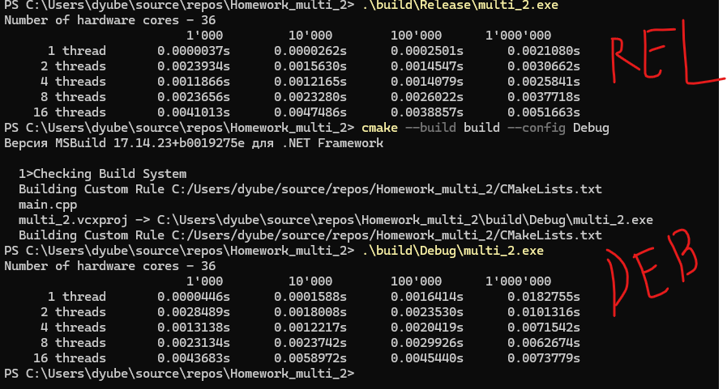

# Build

Run the following commands in your terminal:
```bash
cmake -S . -B build
cmake --build build --config Release
cmake --build build --config Debug
```

---

# Run

After building, run the executable:
```bash
.\build\Release\multi_2.exe

.\build\Debug\multi_2.exe
```

# Conclusion
In the release version, a single thread is faster; in the debug version, parallelization yields better results.

